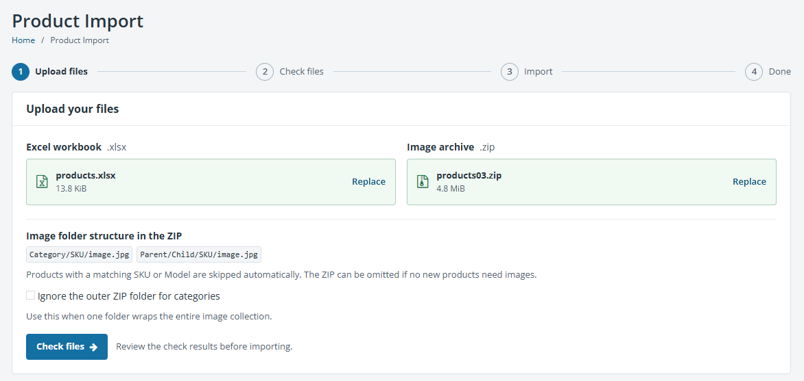
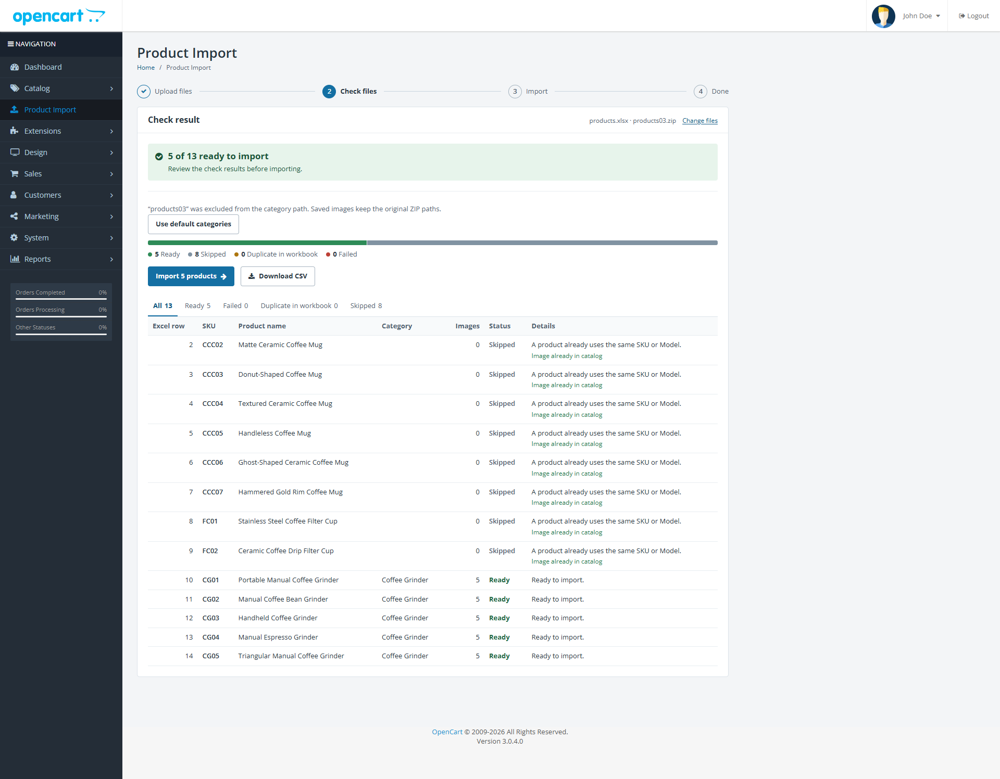
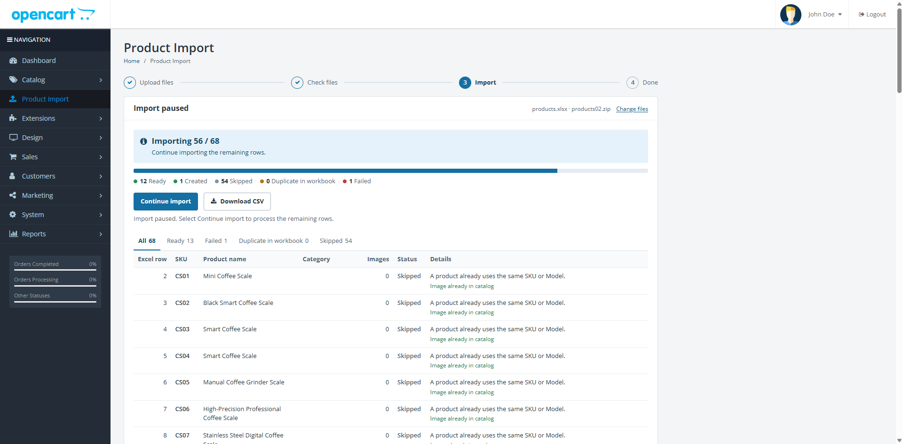
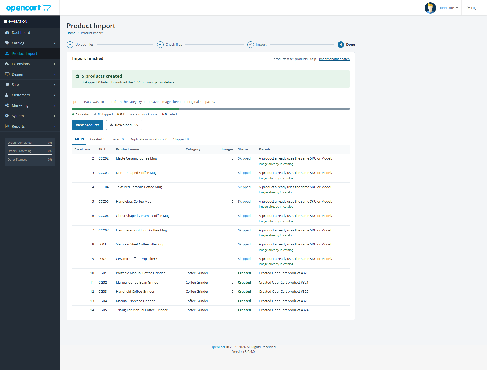

<h1 align="center">OpenCart 3 Product Import</h1>

<p align="center">Import products from an Excel workbook and an image ZIP, directly in the OpenCart admin.</p>

<p align="center">
  <a href="https://github.com/NothiZ/opencart3-product-import/actions/workflows/test-and-release.yml"></a>
</p>

<p align="center">
  <a href="https://github.com/NothiZ/opencart3-product-import/releases/latest">Download latest release</a> ·
  <a href="./README.zh-CN.md">简体中文</a> ·
  <a href="./LICENSE">MIT license</a>
</p>



## Features

- **Check before you import.** A preflight lists every row as ready, skipped, duplicate or failed. Nothing is written to the catalog until you confirm.
- **Images from a ZIP.** Folders in the ZIP decide the product categories and the image order. The first image becomes the main image.
- **Variants.** Sizes, colors and other choices become OpenCart product options.
- **Safe to interrupt.** Pause after the current row and continue later. Rows that were already imported are never imported twice.
- **A clear result.** Every row has a status and, if it needs fixing, a message that says what to change. Download the full list as a CSV.

## Quick start

1. Download `nothiz_product_import_oc3.ocmod.zip` from the [latest release](https://github.com/NothiZ/opencart3-product-import/releases/latest) (under **Assets**).
2. In the OpenCart admin, upload the ZIP under **Extensions → Installer**.
3. Open **Extensions → Extensions**, select **Modules**, and install **Product Import**. Then open **Product Import** from the sidebar.

When upgrading, uninstall the previous module and remove its installer entry before uploading the new ZIP, then install the module again. Uninstalling only removes the sidebar entry. Imported products, categories and images stay in your store.

## Import workflow


| Step             | What to do                                                                                                                                                   |
| ---------------- | ------------------------------------------------------------------------------------------------------------------------------------------------------------ |
| **Upload files** | Choose the Excel workbook and, if it contains new products, the image ZIP.                                                                                   |
| **Check files**  | Review categories and the status of every row. Products whose SKU or Model already exists are skipped. SKUs repeated in the workbook are flagged separately. |
| **Import**       | Select**Import** and confirm. Use **Pause import** to stop after the current row, and **Continue import** to resume in the same admin session.               |
| **Done**         | Open the created products, download the CSV with the result of each row, or start another batch.                                                             |

The preview shows the first 100 rows of the selected filter. The CSV always contains every row, in the language of the admin.

<details>
<summary><strong>Check results</strong> · Review categories and skipped rows</summary>



</details>

<details>
<summary><strong>Pause and resume</strong> · Continue the remaining rows</summary>



</details>

<details>
<summary><strong>Import finished</strong> · View products and download the CSV</summary>



</details>

## Prepare the files

### Excel workbook

Use an `.xlsx` file. The importer reads the first worksheet, and the first row must contain the column names.


| Columns  | Names                                                                                                                                        |
| -------- | -------------------------------------------------------------------------------------------------------------------------------------------- |
| Required | `sku`, `title`, `price`, `description`                                                                                                       |
| Optional | `quantity`, `status`, `meta_title`                                                                                                           |
| Variants | `variant_name_1`, `variant_value_1`, `variant_price_1`. Add more groups as `_2`, `_3` and so on. A single group without a number also works. |

Example:


| sku  | title                 | price | description            | quantity | status | variant_name_1 | variant_value_1 | variant_price_1 |
| ---- | --------------------- | ----- | ---------------------- | -------- | ------ | -------------- | --------------- | --------------- |
| CG01 | Manual Coffee Grinder | 39.90 | Stainless steel burrs. | 50       | 1      | Color          | Black, Silver   | 0, 2            |

Notes:

- **Price** must be a plain number such as `39.90`. Currency symbols and thousands separators are not accepted.
- **Description** is plain text. A blank line starts a new paragraph and a single line break becomes a line break. HTML tags are not interpreted and appear as text.
- **Quantity** is a whole number. **Status** accepts `1`, `0`, `true`, `false`, `yes` or `no`.
- **Variants.** Separate values with commas, vertical bars or line breaks. Values and price adjustments match by position. In the example, `Black` adds 0 and `Silver` adds 2. `S, M, L` with `0, 0, -2` reduces the price of `L` by 2. A blank adjustment counts as 0.
- **SKUs with leading zeros** must be stored as text in Excel, or Excel will remove the zeros.

### Image ZIP

Put each product's images in a folder named after its SKU. Place that folder inside its category folder:

```text
images.zip
├── Coffee Grinder/                 Category
│   ├── CG01/                       SKU
│   │   ├── 1.jpg                   Main image
│   │   └── 2.jpg
│   └── CG02/
│       └── 1.png
└── Kitchen/Coffee Scale/CS01/1.jpg Parent / Child / SKU / image
```

- Use `Category/SKU/image.jpg` or `Parent/Child/SKU/image.jpg`. The folder name must match the SKU in the workbook, and each SKU needs exactly one folder.
- Files are sorted naturally (`1.jpg`, `2.jpg`, `10.jpg`). The first one is the main image.
- JPG and PNG are supported. WebP needs OpenCart 3.0.3.9 or later and WebP support in PHP GD.
- Files that are not images, and macOS or Windows system files, are listed as warnings and ignored.
- The importer checks the workbook first. If every product is already in the catalog, you can omit the ZIP.

**Outer folder.** Some tools wrap the whole ZIP in one folder. In that case, select **Ignore the outer ZIP folder for categories**. For `products03/Coffee Grinder/CG01/1.jpg`, the product goes into the **Coffee Grinder** category and the image is saved to `image/catalog/nothiz_product_import/products03/Coffee Grinder/CG01/1.jpg`. You can switch this option during the check. If the ZIP has no shared outer folder above the category folders, the check says so and keeps the default categories.

**Saved images.** Images are saved under `image/catalog/nothiz_product_import/` with the same folders and file names as in the ZIP. If a file already exists at that path with identical content, it is reused. If the content is different, the row fails with a conflict. The importer never overwrites existing images. It also does not delete images when you delete a product in OpenCart.

**Reusing a ZIP.** The server keeps up to three uploaded ZIPs for up to 72 hours, so choosing the same file again skips the upload. The images are still checked against the current catalog.

## What the import creates

For every new product, the importer creates:

- A product with the SKU saved as both **SKU** and **Model**, added to the default store.
- The product name, and a meta title that defaults to the product name. The same text is saved for every enabled content language.
- Categories from the folder names. Existing categories are matched by name under the same parent, and missing ones are created as enabled categories.
- A main image and a gallery from the ZIP.
- Product options for each variant group. Existing options with the same name are reused. The variant values also appear in a **Specifications** attribute group.

Defaults:


| Setting                               | Value                                                                |
| ------------------------------------- | -------------------------------------------------------------------- |
| Quantity                              | `1000` when the column is empty                                      |
| Status                                | Enabled when the column is empty. The product goes live immediately. |
| Shipping                              | Required                                                             |
| Tax class, weight, manufacturer       | None,`0`, none                                                       |
| Tags, meta description, meta keywords | Empty                                                                |

Set `quantity` and `status` in the workbook if these defaults do not suit your store. Use `status` = `0` to review products before they go live.

## Not supported

- Updating existing products. Rows with a matching SKU or Model are skipped, never changed.
- Importing into a store other than the default store.
- SEO URLs. Products and new categories use OpenCart's default URLs until you add keywords.
- Fields such as manufacturer, weight, dimensions, special prices, tags and meta description.
- Worksheets other than the first one.
- OpenCart 4.x.

## Requirements and limits

- **OpenCart 3.x** and **PHP 7.3+** with the ZIP, DOM, GD and mbstring extensions.
- An admin user group with access and modify permission for the module.
- Writable upload and image directories. The image filesystem must support PHP hard links (the `link()` function), so that new files can be saved without overwriting existing ones.


| Item                                        |          Limit |
| ------------------------------------------- | -------------: |
| Excel workbook                              |         24 MiB |
| Product rows per workbook                   |         10,000 |
| Image ZIP                                   |        320 MiB |
| Entries per ZIP                             |         10,000 |
| Uncompressed ZIP                            |        768 MiB |
| Single image                                |         15 MiB |
| Images per SKU                              |            100 |
| `sku`, option name                          |  64 characters |
| `title`, `meta_title`, category folder name | 255 characters |
| Option value                                | 128 characters |
| Saved image path                            | 255 characters |

The browser uploads in chunks of up to 4 MiB, with up to three parallel image requests. It uses smaller chunks if the server returns HTTP 413. The ZIP check runs in batches and can resume in the same admin session. A check or import that is not finished within 24 hours expires, and you need to upload the files again.

Jobs and cached ZIPs are stored under OpenCart's `DIR_UPLOAD`. The plugin creates Apache protection files for those folders. On Nginx, or when Apache `AllowOverride` is disabled, move the OpenCart storage directory outside the web root or block its public URL in the server configuration.

## Troubleshooting


| What you see                                                     | Likely cause and fix                                                                                                                                                                                                                                            |
| ---------------------------------------------------------------- | --------------------------------------------------------------------------------------------------------------------------------------------------------------------------------------------------------------------------------------------------------------- |
| Every row fails with**Cannot save …** although the check passed | The server cannot create hard links. PHP`disable_functions` may include `link`, or the image folder is on a filesystem without hard-link support. Ask your host, or run `php -r 'var_dump(function_exists("link"));'`. It must print `bool(true)`.              |
| **An existing path conflicts with …**                           | A different file already exists at that path. This often happens when you delete imported products and import again with edited images that keep their names. Rename the new file or folder, or remove the old file from`image/catalog/nothiz_product_import/`. |
| **No unique image folder matches this SKU**                      | The folder name does not match the SKU, the folder is missing, or the SKU appears in more than one place. Match the folder name to the workbook SKU.                                                                                                            |
| **Invalid folder layout …**                                     | The path has too many or too few levels. Use`Category/SKU/image.jpg` or `Parent/Child/SKU/image.jpg`. If one folder wraps everything, select **Ignore the outer ZIP folder for categories**.                                                                    |
| **price must be a valid price …**                               | The cell is empty or contains text, a currency symbol or a thousands separator. Use a plain number such as`39.90`.                                                                                                                                              |
| A SKU lost its leading zeros                                     | Format the SKU column as text in Excel before you enter the values.                                                                                                                                                                                             |
| **The server rejects uploads even in 16 KiB chunks**             | The host limits the request size. Ask your host to raise it.                                                                                                                                                                                                    |
| **Cannot acquire the catalog lock**                              | MySQL named locks are not available. Ask your host to enable them.                                                                                                                                                                                              |
| **This preview has expired or is unavailable**                   | The check is older than 24 hours, or you are logged in with a different admin session. Upload the files again.                                                                                                                                                  |

Other errors are written to the OpenCart error log.

## Build and release

Run `python build.py` to build `nothiz_product_import_oc3.ocmod.zip` locally. Pass an output path as the first argument to write it elsewhere.

GitHub Actions runs all PHP tests on every branch push. When you push a new `vX.Y.Z` tag and the tests pass, the workflow builds the ZIP and uploads it to [Releases](https://github.com/NothiZ/opencart3-product-import/releases).

## Roadmap

- [ ]  Add SEO URLs during import.
- [ ]  Check available disk space before importing.
- [ ]  Add OpenCart 4.x compatibility.

## License

This project uses the [MIT license](LICENSE). The bundled js-sha256 library keeps its own [MIT notice](upload/admin/view/javascript/nothiz/LICENSE.txt).

<p align="center">Import products from Excel and an image ZIP directly in the OpenCart admin.</p>

<p align="center">
  <a href="https://github.com/NothiZ/opencart3-product-import/releases/latest">Download latest release</a> ·
  <a href="./README.zh-CN.md">简体中文</a> ·
  <a href="https://github.com/NothiZ/opencart3-product-import/actions">Test runs</a> ·
  <a href="./LICENSE">MIT license</a>
</p>


## Quick start

1. Download `nothiz_product_import_oc3.ocmod.zip` from the latest release assets. [GitHub Releases](https://github.com/NothiZ/opencart3-product-import/releases/latest)
2. In the OpenCart admin, upload the ZIP under **Extensions → Installer**.
3. Open **Extensions → Extensions**, select **Modules**, and install **Product Import**. Open **Product Import** from the sidebar.

When upgrading, uninstall the previous module and remove its installer entry before uploading the new ZIP. Then install the module again.

## Import workflow


| Step             | What to do                                                                                                                                             |
| ---------------- | ------------------------------------------------------------------------------------------------------------------------------------------------------ |
| **Upload files** | Choose the Excel workbook and, for new products, an image ZIP.                                                                                         |
| **Check files**  | Review categories and row statuses before importing. Existing SKU or Model matches are skipped. Duplicate SKUs in the workbook are flagged separately. |
| **Import**       | Confirm the ready rows. You can pause after the current row and continue in the same admin session.                                                    |
| **Done**         | Open the created products or download a CSV with the results for each row.                                                                             |

Preflight lists unsupported files as warnings. Invalid images and folder layouts are reported with the affected SKU and ZIP path when the SKU can be identified. The CSV follows the active admin language.

<details>
<summary><strong>Check results</strong> · Review categories and skipped rows</summary>


</details>

<details>
<summary><strong>Pause and resume</strong> · Continue the remaining rows</summary>


</details>

<details>
<summary><strong>Import finished</strong> · View products and download the CSV</summary>


</details>

## Prepare the files

### Excel workbook

The importer reads the first worksheet of an `.xlsx` file.


| Columns  | Names                                                                                                                                            |
| -------- | ------------------------------------------------------------------------------------------------------------------------------------------------ |
| Required | `sku`, `title`, `price`, `description`                                                                                                           |
| Optional | `quantity`, `status`, `meta_title`                                                                                                               |
| Variants | `variant_name_1`, `variant_value_1`, `variant_price_1`, with further groups numbered `_2`, `_3` and so on. A single unnumbered group also works. |

Format SKUs with leading zeros as text in Excel. Variant values and price adjustments are matched by position. For example, `S, M, L` with `0, 0, -2` reduces the price for `L` by 2. A blank adjustment defaults to zero.

### Image ZIP

Use one folder per SKU, under `Category/SKU/image.jpg` or `Parent/Child/SKU/image.jpg`. Filenames are sorted naturally, so `1.jpg`, `2.jpg` and `10.jpg` appear in that order. The first image becomes the main image.

If a single outer folder wraps the ZIP, select **Ignore the outer ZIP folder for categories**. With `products03/Coffee Grinder/CG01/1.jpg`, this creates the **Coffee Grinder** category and saves the image at `image/catalog/nothiz_product_import/products03/Coffee Grinder/CG01/1.jpg`. You can toggle the option during preflight. If the ZIP has no shared outer folder above the category folders, preflight reports this and uses the default category rules.

- JPG and PNG are supported. WebP requires OpenCart 3.0.3.9 or later and WebP support in PHP GD.
- The importer checks the workbook first. You can omit the ZIP when every product is already in the catalog.
- A saved file is reused when its path and content both match. A file at the same path with different content is reported as a conflict.
- Matching archives can be reused for up to 72 hours, with a cache of up to three ZIPs. Preflight still checks the images against the current catalog paths.

## Requirements and limits

- **OpenCart 3.x** and **PHP 7.3+** with ZIP, DOM, GD and mbstring.
- An admin user group with access and modify permissions for the module. Products are imported into the default store.
- Writable upload and image directories. The image filesystem must support PHP hard links so new files can be saved without overwriting existing ones.


| Item             |   Limit |
| ---------------- | ------: |
| Excel workbook   |  24 MiB |
| Image ZIP        | 320 MiB |
| Uncompressed ZIP | 768 MiB |
| Single image     |  15 MiB |

The browser uploads in chunks of up to 4 MiB, with up to three parallel image requests. It reduces the chunk size when the server returns HTTP 413. ZIP preflight runs in batches and can resume in the same admin session.

Jobs and cached ZIPs are stored under OpenCart's `DIR_UPLOAD`. The plugin creates Apache protection files for those directories. On Nginx or when Apache `AllowOverride` is disabled, move the OpenCart storage directory outside the web root or block its public URL in the server configuration.

## Build and release

Run `python build.py` to build `nothiz_product_import_oc3.ocmod.zip` locally. Pass an output path as the first argument to build it elsewhere.

GitHub Actions runs all PHP tests on branch pushes. To publish a new version, push a new `vX.Y.Z` tag. If the tests pass, the workflow builds the ZIP and uploads it to Releases. [GitHub Actions](https://github.com/NothiZ/opencart3-product-import/actions)

## Roadmap

- [ ]  Add SEO URLs during import.
- [ ]  Check available disk space before importing.
- [ ]  Add OpenCart 4.x compatibility.

## License

This project uses the MIT license. The bundled js-sha256 library retains its own MIT notice. [Project license](LICENSE) · [js-sha256 license](upload/admin/view/javascript/nothiz/LICENSE.txt)
