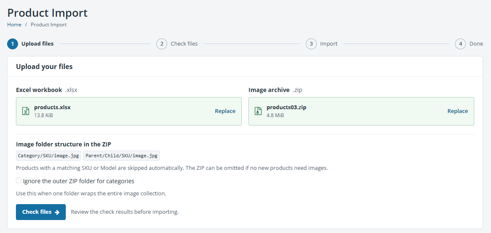
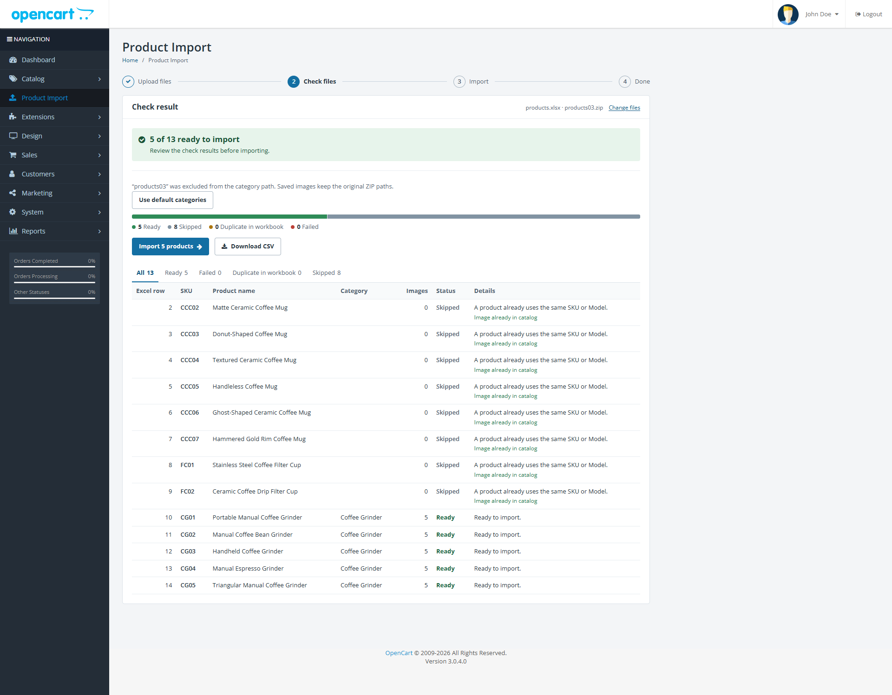
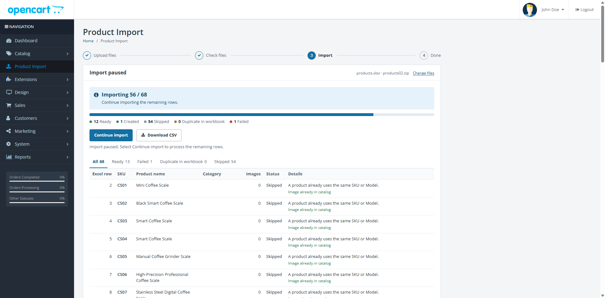
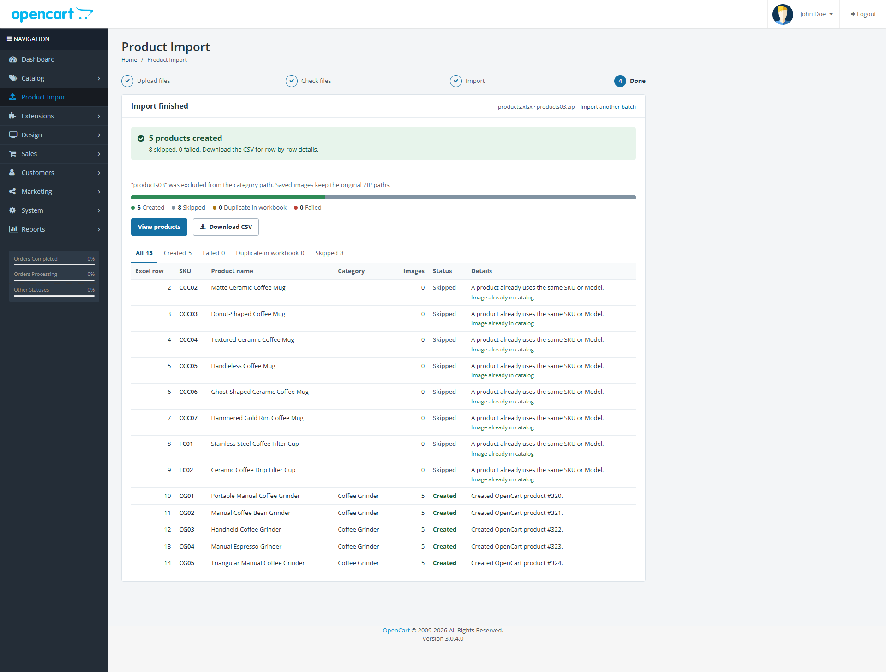

<h1 align="center">OpenCart 3 批量商品导入</h1>

在 OpenCart 后台通过 Excel 和图片 ZIP 批量导入商品。

  <a href="https://github.com/NothiZ/opencart3-product-import/releases/latest">下载最新安装包</a> ·
  <a href="./README.md">English</a> ·
  <a href="https://github.com/NothiZ/opencart3-product-import/actions">测试记录</a> ·
  <a href="./LICENSE">MIT 许可证</a>

## 快速安装

1. 在最新发布版本的 **Assets** 下载 `nothiz_product_import_oc3.ocmod.zip`。[GitHub Releases](https://github.com/NothiZ/opencart3-product-import/releases/latest)
2. 打开 OpenCart 后台的 **扩展 → 安装器**，上传安装包。
3. 进入 **扩展 → 扩展**，选择 **模块**，安装 **商品导入**，然后在左侧菜单打开它。英文后台显示为 **Product Import**。

升级时，先卸载旧模块并移除旧的安装记录，再上传新版安装包并重新安装模块。

## 导入流程

| 步骤 | 操作 |
| --- | --- |
| **上传文件** | 选择 Excel 商品表。有新商品时再选择图片 ZIP。 |
| **预检** | 核对分类和每行状态。后台已有相同 SKU 或 Model 的商品会跳过，Excel 内重复的 SKU 会单独标记。 |
| **导入** | 确认导入待处理行。可以在当前行完成后暂停，并在同一后台会话中继续。 |
| **完成** | 查看创建的商品，或下载记录每行结果的 CSV。 |

预检会列出忽略的杂文件。坏图或目录异常会显示 ZIP 路径，并在能识别 SKU 时标记对应行。CSV 使用当前后台语言。

<strong>预检结果</strong> · 查看分类和跳过的行

<strong>暂停与续跑</strong> · 继续处理剩余行

<strong>导入完成</strong> · 查看商品并下载 CSV

## 准备导入文件

### Excel 商品表

使用 `.xlsx` 文件，插件读取第一张工作表。

| 列类型 | 列名 |
| --- | --- |
| 必填 | `sku`、`title`、`price`、`description` |
| 可选 | `quantity`、`status`、`meta_title` |
| 变体 | `variant_name_1`、`variant_value_1`、`variant_price_1`，多组依次用 `_2`、`_3` 等编号。也支持无编号的单组变体列。 |

SKU 含前导零时，请在 Excel 中将该列设为文本。变体值和价格调整按位置对应。例如 `S, M, L` 配 `0, 0, -2` 时，`L` 减价 2。价格调整留空时按 0 处理。

### 图片 ZIP

每个 SKU 使用一个独立目录，格式为 `分类/SKU/图片.jpg` 或 `父分类/子分类/SKU/图片.jpg`。文件名按自然顺序排列，例如 `1.jpg`、`2.jpg`、`10.jpg`，第一张作为主图。

如果所有图片共用一个打包目录，可以勾选 **忽略 ZIP 最外层文件夹（仅影响分类）**。以 `products03/Coffee Grinder/CG01/1.jpg` 为例，勾选后商品归到 **Coffee Grinder**，图片保存到 `image/catalog/nothiz_product_import/products03/Coffee Grinder/CG01/1.jpg`。预检时也能切换。如果分类目录之上没有共同的外层文件夹，预检会提示并沿用默认分类。

- 支持 JPG 和 PNG。WebP 需要 OpenCart 3.0.3.9 或以上版本，并且 PHP GD 支持 WebP。
- 插件会先检查商品表。如果后台已有所有商品，可以省略图片 ZIP。
- 路径与内容都相同的图片会直接复用。同路径图片内容不同会提示冲突。
- 同一份 ZIP 可从服务器缓存复用，最多保留 3 份，每份最长可复用 72 小时。预检仍会检查当前后台中的同路径图片。

## 运行条件与限制

- **OpenCart 3.x** 和 **PHP 7.3+**，启用 ZIP、DOM、GD 和 mbstring。
- 后台用户组需拥有模块的访问和修改权限。商品会导入到当前 OpenCart 的默认店铺。
- 上传目录和图片目录需可写。图片目录所在文件系统需支持 PHP 硬链接，以免保存新图时覆盖已有文件。

| 项目 | 上限 |
| --- | ---: |
| Excel 商品表 | 24 MiB |
| 图片 ZIP | 320 MiB |
| ZIP 解压后 | 768 MiB |
| 单张图片 | 15 MiB |

浏览器分块上传，每块最多 4 MiB，图片最多三个请求并行。遇到 HTTP 413 时会自动缩小分块。ZIP 预检分批执行，可在同一后台会话中继续。

任务和缓存 ZIP 保存在 OpenCart 的 `DIR_UPLOAD` 下，插件会为这些目录创建 Apache 访问保护文件。使用 Nginx 或禁用了 Apache `AllowOverride` 时，请将 OpenCart 的 storage 目录移出网站根目录，或在服务器配置中阻止外部访问其 URL。

## 构建与发布

运行 `python build.py`，在本地生成 `nothiz_product_import_oc3.ocmod.zip`。也可以通过第一个参数指定输出位置。

推送分支时，GitHub Actions 会运行全部 PHP 测试。推送一个新的 `vX.Y.Z` 标签时，测试通过后会生成安装包并上传到 Releases。[GitHub Actions](https://github.com/NothiZ/opencart3-product-import/actions)

## 待更新

- [ ] 加 SEO URL
- [ ] 导入前检查磁盘空间
- [ ] 适配 OpenCart 4.x 版本

## 许可证

项目采用 MIT 许可证。随插件提供的 js-sha256 保留其原有的 MIT 许可声明。[项目许可证](LICENSE) · [js-sha256 许可证](upload/admin/view/javascript/nothiz/LICENSE.txt)
